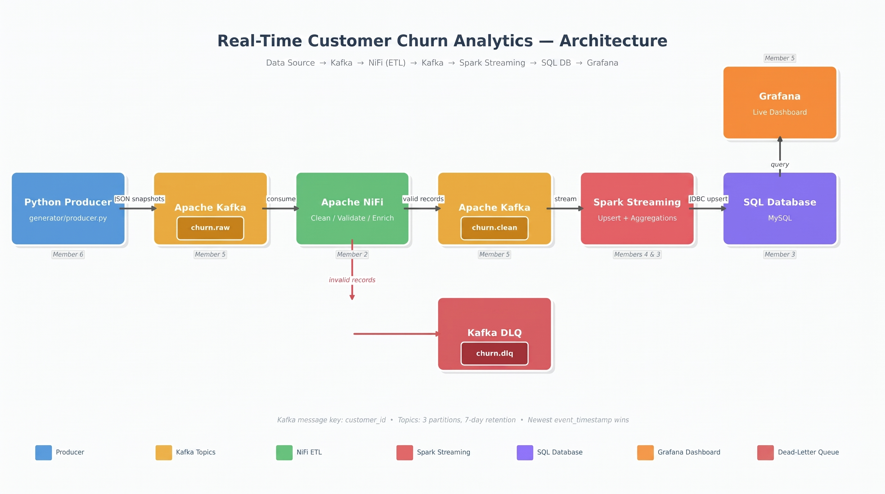

# 📡 Replay-Based Near-Real-Time Customer Churn Analytics

## 📝 Project Overview

**Customer churn** happens when a customer cancels a subscription and leaves the company. For a telecom provider, losing customers is expensive because acquiring a new customer can cost more than retaining an existing one.

This project demonstrates a **replay-based streaming pipeline** that reads customer snapshots from a historical CSV file, publishes them continuously to Kafka, validates them with NiFi, processes valid records with Spark Structured Streaming, stores the current customer state in MySQL, and displays analytics in Grafana.

The pipeline uses **Python, Apache Kafka, Apache NiFi, Apache Spark Structured Streaming, MySQL 8, and Grafana**. Records arrive as a stream during replay, so the dashboard updates as processing progresses.

> **Scope clarification:** This is near-real-time processing of replayed historical customer snapshots, not a connection to a live telecom event source. The source file has one row per customer and no event timestamp. The producer adds an ingestion timestamp when it publishes each row. The project demonstrates streaming ingestion and processing, but it does not demonstrate a customer's state evolving through a sequence of real historical snapshots.



```text
churn_raw.csv ──► Python producer ──► Kafka (churn.raw) ──► NiFi (clean + validate) ──┬──► Kafka (churn.clean) ──► Spark Structured Streaming ──► MySQL ──► Grafana
                  (file-order replay)                                                │                               (features + risk points)
                                                                                      └──► Kafka (churn.dlq)
                                                                                           (invalid records + error_reason)
```

---

## 📊 Dataset Description

The source file is `churn_raw.csv`: **200,000 rows and 58 columns** describing telecom customers in **California, Q3 2025**. It includes demographics, services, billing, usage over the last month and the last three months, customer-service calls, and churn outcomes. The file belongs in `data/raw/` and is **not committed to Git**; see [`data/README.md`](data/README.md).

Each Kafka message represents one source row and contains **53 fields**: 52 selected columns from the CSV plus `event_timestamp`. The complete field list, types, cleaning rules, validation rules, and message contract are defined in [`docs/data_contract.md`](docs/data_contract.md) (v2.3).

### Dataset at a glance

| Item | Value |
|---|---|
| Source rows | 200,000. This is not 200,000 distinct customers. |
| Source columns | 58. The producer sends 52 and excludes 6 columns listed below. |
| Duplicate rows | 5,000 exact duplicate rows in the source file. |
| Missing customer IDs | 5,009 rows have an empty `customer_id`. |
| Distinct non-empty IDs | 190,132 distinct non-empty customer IDs in the source file, before pipeline validation. |
| Customer status | `Stayed`, `Churned`, and `Joined`. `Joined` represents 6.4% of source rows and has `churn_label = No` in the dataset. |
| Source event time | None. The producer creates `event_timestamp` at publish time; it is an ingestion timestamp, not the time the customer's behaviour occurred. |
| Currency and units | The source does not state the currency of charges or the unit of `income`. The team assumes US dollars for charges; the unit of `income` remains unknown. |

**Columns not sent:** `country`, `state`, and `quarter` (constant across the file); `churn_value` (a numeric copy of `churn_label`); and `zip_code` and `population` (not currently used by the scoring or dashboard).

### Fields sent to Kafka

| Group | Fields |
|---|---|
| **Identity and time** | `customer_id` (Kafka key when non-empty), `event_timestamp` |
| **Demographics** | `gender`, `age` (nullable), `under_30`, `senior_citizen`, `married`, `dependents`, `number_of_dependents`, `income`, `city` |
| **Referral and offer** | `referred_a_friend`, `number_of_referrals`, `offer` |
| **Services and plan** | `tenure_in_months`, `phone_service`, `avg_monthly_long_distance_charges`, `multiple_lines`, `internet_service`, `internet_type`, `avg_monthly_gb_download`, `premium_tech_support`, `streaming_tv`, `streaming_movies`, `streaming_music`, `unlimited_data`, `contract`, `paperless_billing`, `payment_method` |
| **Billing** | `monthly_charge`, `total_charges` (nullable), `total_refunds`, `total_extra_data_charges`, `total_long_distance_charges`, `total_revenue`, `cltv` |
| **Behaviour** | `calls_1m`, `calls_3m`, `sms_1m`, `sms_3m`, `purchases_1m`, `purchases_3m`, `data_usage_gb_1m`, `data_usage_gb_3m`, `customer_service_calls_1m`, `customer_service_calls_3m`. Each 3-month total includes the last month. |
| **Evaluation only** | `customer_status`, `churn_label`, `churn_date`, `churn_category`, `churn_reason`, `churn_score`, `satisfaction_score`. They may be carried and stored for evaluation, but must never be used to derive features or calculate risk scores. |
| **Created by Spark** | `age_group`, `tenure_group`, five behaviour-trend fields, `risk_score`, `risk_level`, `risk_reasons` |

### Data-quality characteristics

These are measured characteristics recorded for the selected 58-column export:

| Problem | Rows / frequency |
|---|---:|
| Empty `customer_id` | 5,009 |
| Exact duplicate rows | 5,000 |
| Impossible `age` values (`-1`, `0`, `150`, `999`) | 3,249 |
| Impossible `tenure_in_months` values (`-5`, `150`, `999`) | 3,792 |
| Impossible `monthly_charge` values (`-50`, `-1`, `0`, `9999`) | 4,989 |
| Impossible `satisfaction_score` values (`0`, `6`, `10`, `99`) | 5,005 |
| Mixed gender spellings (`Male`, `male`, `M`, `Male `, `Female`, `FEMALE`, `F`) | About 10,000 |
| Missing `age` | 35% (allowed; not a validation error) |
| Missing `total_charges` | 5% (allowed; not a validation error) |
| `churn_date` values parsed outside Q3 | 1,488 rows in the current CSV; all are labelled `Churned`. Of these, 39 also have an empty `customer_id`, so 1,449 are first-failure `RULE_2_BAD_DATE` records. A prior-export comparison found 320 additional day/month mismatches, but those cannot be identified or reproduced from this CSV alone. |

The measured analysis is provided in [`docs/dataset_profile.md`](docs/dataset_profile.md), generated from the same 58-column `churn_raw.csv` export described here. It uses the trend definition in the data contract. Re-run the profile if the source CSV changes; do not carry measurements across exports or trend formulas.

> ⚠️ **Evaluation limitation:** Some behaviour fields have unusually strong associations with the churn labels. In particular, `calls_*` and `sms_*` separate the labelled groups almost perfectly; `customer_service_calls_3m` and `purchases_3m` are also strongly associated. This may reflect label-dependent data generation or other target leakage. Very high precision, recall, or AUC on this file would demonstrate retrospective agreement with its labels, not proven ability to predict future churn in a live customer population.

---

## ⚖️ Project Rules

- **One contract:** All stages use the schema, field names, types, topic names, and key defined in [`docs/data_contract.md`](docs/data_contract.md) v2.3. Changes require approval from the team leader and must be communicated to the whole team.
- **Replay order:** The producer sends records in file order. The file has no event time; `event_timestamp` is the real UTC time at which the producer publishes a record.
- **Producer serialization is not cleaning:** The producer uses the contract to serialize CSV values into the correct JSON types. It does not trim text, normalize spelling, convert dates, fill missing values, or repair invalid values. Empty cells remain empty strings so NiFi can apply the contract's nullable-field rules.
- **Header-based input:** The producer selects columns by header name and stops if a required header is missing or any source header is empty. It must not depend on column positions.
- **NiFi cleaning is formatting-only:** NiFi trims strings, normalizes gender spellings, applies the documented `churn_date` parsing rule, and converts empty strings to `null` in the seven nullable fields. It does not repair ranges, infer ambiguous dates, or fill missing values.
- **No silent drops:** Invalid records are sent to `churn.dlq` with the first failed rule code, `failed_at_timestamp`, and `raw_payload` when the message cannot be parsed.
- **DLQ retention:** `churn.dlq` has no time limit. No consumer or replay process is defined for it yet.
- **Evaluation isolation:** The seven evaluation-only fields are not allowed in feature derivation or risk scoring. A test must verify that scoring code does not read them.
- **Latest received record wins:** MySQL updates a customer's stored row only when the incoming `event_timestamp` is newer. Because the source contains one snapshot per customer, this primarily handles exact duplicate records and does not represent a sequence of real customer-state changes.
- **Current-state analytics:** Summary tables and views are based on `customers_current_state`, not by aggregating every stream message. This prevents replayed duplicate rows from inflating customer counts.
- **Scoring source of truth:** Points and risk-level thresholds belong in [`docs/scoring_rules.md`](docs/scoring_rules.md). They are not finalized by this README or the data contract.
- **Expected-count verification:** `scripts/verify_pipeline.py` is intended to check the expected counts below after a full replay.
- **Team workflow:** Each module is developed on its own Git branch and submitted through a pull request. Each stage is reviewed by a teammate and checked by the team leader for contract compliance before merging into `main`.

### Expected results of a full replay

These are contract expectations for the specified dataset export and validation order. Recompute them if the source CSV changes.

| Result | Expected rows |
|---|---:|
| Sent to `churn.raw` | 200,000 |
| Rejected to `churn.dlq` | **22,468 (11.2%)**: 5,009 `RULE_2_BAD_ID`, 1,449 `RULE_2_BAD_DATE`, and 16,010 `RULE_3_OUT_OF_RANGE` |
| Published to `churn.clean` | **177,532**, including 4,433 exact duplicate rows |
| Rows in `customers_current_state` | **173,099**: 117,194 `Stayed`, 44,739 `Churned`, and 11,166 `Joined` |

The real file is expected not to trigger Rules 1, 4, 5, or 6. The producer's `--inject-errors` option is therefore required to test those paths. Rule 3 cause counts overlap at row level; the total number of records first rejected by Rule 3 is 16,010.

**Churn-share caveat:** the 1,488 current-file rows whose parsed `churn_date` falls outside Q3 are all labelled `Churned`. Thirty-nine of those rows also have an empty `customer_id` and fail the ID check first, leaving 1,449 first-failure date rejections. The expected current-state table contains 44,739 churned customers out of 173,099 (25.8%), compared with 51,526 out of 195,000 rows after exact-duplicate removal in the source (26.4%). The state table is filtered by all validation rules, so these percentages describe different populations; the date rule specifically removes churn-labelled rows because of an export-format problem, not because those customers are known to be invalid.

---

## 🧱 Pipeline Components

### 1. Python Producer (`producer/`)

Reads `churn_raw.csv` by header name, selects the 52 contracted columns, serializes values into contract-compatible JSON types, adds `event_timestamp`, and publishes one message per source row to `churn.raw` in file order. It uses `customer_id` as the Kafka key when the ID is non-empty; a row with an empty ID is published with a null Kafka key while retaining the empty `customer_id` in its payload.

For JSON serialization:

- Integer fields are emitted as JSON integers; numeric fields are emitted as JSON numbers; text fields remain JSON strings.
- Parseable numeric values are serialized as numbers, including out-of-range values such as `9999` so NiFi can reject them under the range rule.
- A non-numeric token in a numeric field is preserved as a JSON string so the type-validation rule can reject it.
- Empty cells are emitted as empty strings. NiFi converts empty strings to `null` only for the seven nullable fields defined in the contract.
- The producer does not trim, case-normalize, change dates, fill values, or repair records.

A `--inject-errors` option adds test records that exercise validation rules not naturally triggered by the source file.

Approximate replay duration for 200,000 records:

| Publish rate | Approximate duration |
|---:|---:|
| 10 messages/second | 5 hours 33 minutes |
| 100 messages/second | 33 minutes |
| 1,000 messages/second | 3 minutes 20 seconds |

Choose `--rate` based on the demo duration and the processing capacity of the environment.

### 2. Apache Kafka

Kafka decouples the pipeline stages. Records with the same non-empty `customer_id` key are assigned to the same partition, preserving their partition order. A record with an empty `customer_id` uses a null key; it does not receive per-customer ordering guarantees and is expected to be rejected by NiFi.

| Topic | Purpose | Retention |
|---|---|---|
| `churn.raw` | Raw customer snapshots from the producer | 7 days |
| `churn.clean` | Cleaned and validated records from NiFi | 7 days |
| `churn.dlq` | Invalid records rejected by NiFi, with error information | No time limit (`retention.ms=-1`) |

### 3. Apache NiFi (ETL) (`nifi/`)

NiFi consumes `churn.raw` and processes each message in this order:

1. **Cleaning:** formatting only—trim strings, normalize gender spellings, convert `churn_date` using the exact contract rule, and convert empty strings to `null` in the seven nullable fields.
2. **Validation:** six rules evaluated in order: JSON parsing/presence/types; identity and dates; ranges; allowed values; cross-field consistency; churn consistency.
3. **Routing:** valid records go to `churn.clean`; invalid records go to `churn.dlq` with the first failed rule code.

NiFi does not enrich records. All derived fields and risk flags are created in Spark. Processor order and routing are documented in [`docs/nifi_rules.md`](docs/nifi_rules.md).

### 4. Apache Spark Structured Streaming (`spark/`)

Spark reads `churn.clean` from the earliest available offset, parses records with an explicit schema, uses checkpointing for fault tolerance and recovery, and writes to MySQL through `foreachBatch`. Customer state is maintained in MySQL. The current design does not use event-time windows, so watermarks are not required for these operations.

Each micro-batch follows these steps (database writing is implemented in `spark/utils/db_upsert.py`):

1. **Dedupe:** keep the record with the newest `event_timestamp` for each `customer_id` within the micro-batch.
2. **Derive fields:** calculate `age_group` (`unknown` when age is null), `tenure_group`, and five behaviour trends. For each pair, the trend is the last-month value divided by the average of the two months before it: `x_1m / ((x_3m - x_1m) / 2)`. The result is `null` when the denominator is zero.
3. **Score:** use the approved points in `docs/scoring_rules.md` to calculate `risk_score`, `risk_level`, and `risk_reasons`. Evaluation-only fields must not be read by this step.
4. **Stage:** write the micro-batch to a MySQL staging table over JDBC.
5. **Upsert:** insert from the staging table into `customers_current_state`, updating an existing customer only when the incoming `event_timestamp` is newer.

How the population reference (for example, a median) is obtained and refreshed during streaming remains an open design decision. One option is to calculate it from `customers_current_state` and have Spark read a consistent reference at the start of each micro-batch.

### 5. MySQL Database and Grafana Dashboard (`sql/` and `dashboard/`)

- **MySQL:** stores `customers_current_state`, the staging table, and analytical views.
- **Grafana:** connects through the built-in MySQL data source and displays customer counts by risk level, risk by segment, highest-risk customers, risk reasons, and retrospective comparisons with churn labels.
- Customer totals come from `customers_current_state` (**173,099 after the expected full replay**), not from the 200,000 source rows.

---

## 🧠 Analytics and Evaluation

1. **Risk flagging:** a points-based `risk_score` and `risk_level` for each customer, with the signals contributing to the score recorded in `risk_reasons`.
2. **Segment analysis:** risk and churn by `contract`, `internet_type`, `offer`, `payment_method`, `age_group`, and `tenure_group`.
3. **Behaviour trends:** comparison of the last month with the average of the two preceding months for calls, SMS, purchases, data usage, and customer-service calls.
4. **Retrospective evaluation:** compare risk flags with `churn_label` using precision and recall (for example, in `flags_vs_labels`) and compare with the dataset's own `churn_score` as a benchmark. These metrics describe agreement with labels already present in the dataset; they are not prospective prediction results.
5. **Data-quality analysis:** report rejected records by `error_reason` using the DLQ data or a later DLQ storage table, depending on the team's implementation decision.

### Required scoring diagnostics

Before finalizing the scoring points, compare at least:

- **Baseline scenario:** the selected non-evaluation features, with the included feature list documented.
- **Calls/SMS ablation:** repeat the evaluation after excluding `calls_1m`, `calls_3m`, `sms_1m`, and `sms_3m` to show how much the very strong label association affects the results.

Also report the effect of `customer_service_calls_3m` and `purchases_3m`, because the dataset profile identifies them as strongly associated with churn. Do not describe a high retrospective metric as evidence of real-world or forward-looking predictive performance.

For the primary binary comparison, `Joined` customers have `churn_label = No` in the source and are therefore counted as not churned. Report the `Joined` segment separately as well, so readers can see how including new customers affects the evaluation.

---

## 🗄️ Database: MySQL 8

The project uses **MySQL 8.0**, pinned to an exact image tag in `docker-compose.yml` rather than `latest`. Row aliases in upserts require MySQL 8.0.19 or later.

| Item | Value |
|---|---|
| Docker service | `db`, image `mysql:8.0`, health check using `mysqladmin ping` |
| Port | `3306` inside Docker. If the laptop already runs MySQL, map `3307:3306` through `DB_HOST_PORT` in `.env`. |
| `.env` variables | `DB_NAME`, `DB_USER`, `DB_PASSWORD`, `DB_ROOT_PASSWORD`, `DB_HOST_PORT` |
| JDBC URL (Spark) | `jdbc:mysql://db:3306/<DB_NAME>?connectionTimeZone=UTC&rewriteBatchedStatements=true&allowPublicKeyRetrieval=true&useSSL=false` (the last two options are for local development only) |
| JDBC driver (Spark) | `com.mysql:mysql-connector-j` (8.x), passed with `--packages` in `submit_spark.sh` |
| Grafana data source | Built-in MySQL, host `db:3306` |
| Python on the laptop | `pymysql` (listed in `scripts/requirements.txt`) |
| Column types | Timestamps stored as UTC `DATETIME(3)`, `churn_date` as `DATE NULL`, `Yes`/`No` fields as `VARCHAR(3)`, derived flags as `TINYINT(1)`, and `raw_payload` as `TEXT` |
| Nullable columns | `age`, `offer`, `internet_type`, `total_charges`, `churn_date`, `churn_category`, `churn_reason`, and the derived trend fields |
| Tables | `customers_current_state`, staging table `stg_customers`, and `dlq_errors` (the DLQ table remains undecided) |

### How the latest-received-record upsert works

Spark writes each deduplicated micro-batch to the staging table and then runs `INSERT ... SELECT ... ON DUPLICATE KEY UPDATE` into `customers_current_state`.

MySQL evaluates assignments in the `ON DUPLICATE KEY UPDATE` clause from left to right. Each customer column therefore compares the incoming timestamp with the stored timestamp, and `event_timestamp` is assigned last. Assigning it first could cause later comparisons to use the newly assigned timestamp and prevent the intended comparison against the previous value.

```sql
INSERT INTO customers_current_state (customer_id, age, ..., event_timestamp)
SELECT s.customer_id, s.age, ..., s.event_timestamp FROM stg_customers s
ON DUPLICATE KEY UPDATE
  age = IF(s.event_timestamp > customers_current_state.event_timestamp, s.age, customers_current_state.age),
  -- ...same pattern for every other column...
  event_timestamp = IF(s.event_timestamp > customers_current_state.event_timestamp,
                       s.event_timestamp, customers_current_state.event_timestamp);
```

The golden test data should contain duplicate rows and an out-of-order record to test this condition. The full statement belongs in `sql/01_schema.sql` or the database-upsert implementation documentation.

---

## 🔓 Open Decisions and Documentation To Finalize

The current contract defaults are listed in [`docs/data_contract.md`](docs/data_contract.md), Section 11 (D1–D10). The team still needs to finalize:

- **Scoring points:** signals, points, risk-level thresholds, and how the population reference is calculated and refreshed during streaming (`docs/scoring_rules.md`).
- **Use of strongly label-associated behaviour fields:** decide which fields are included in the final score, while keeping the required baseline and ablation diagnostics described above.
- **Population reference consistency:** decide whether medians are calculated in MySQL and read at each micro-batch, cached, or maintained another way.
- **`Joined` customers:** the source labels them `No`; report them as a separate segment as well as under the primary binary-label convention.
- **Churn-date export issue:** the fixed rule detects 1,488 current-file rows outside Q3; all are labelled `Churned`. Thirty-nine also have an empty `customer_id`, so the first-failure count for `RULE_2_BAD_DATE` is 1,449. A prior-export comparison found 320 additional day/month mismatches, but that historical comparison cannot be reproduced from this CSV alone. This is an export-format problem, not evidence that the affected customers are invalid; re-export the dates from the original source in an unambiguous format if accurate dates are required.
- **Missing age:** 35% of rows have a missing age. It remains nullable and is not imputed.
- **DLQ handling:** decide whether to add a `dlq_errors` table, a Grafana panel, or a controlled replay process.
- **Currency and units:** the source does not state the charge currency or the unit of `income`.
- **Dataset profile synchronization:** keep `docs/dataset_profile.md` committed alongside this README and the data contract. Update it from the exact team CSV whenever the export changes, using the same date interpretation and trend formula.
